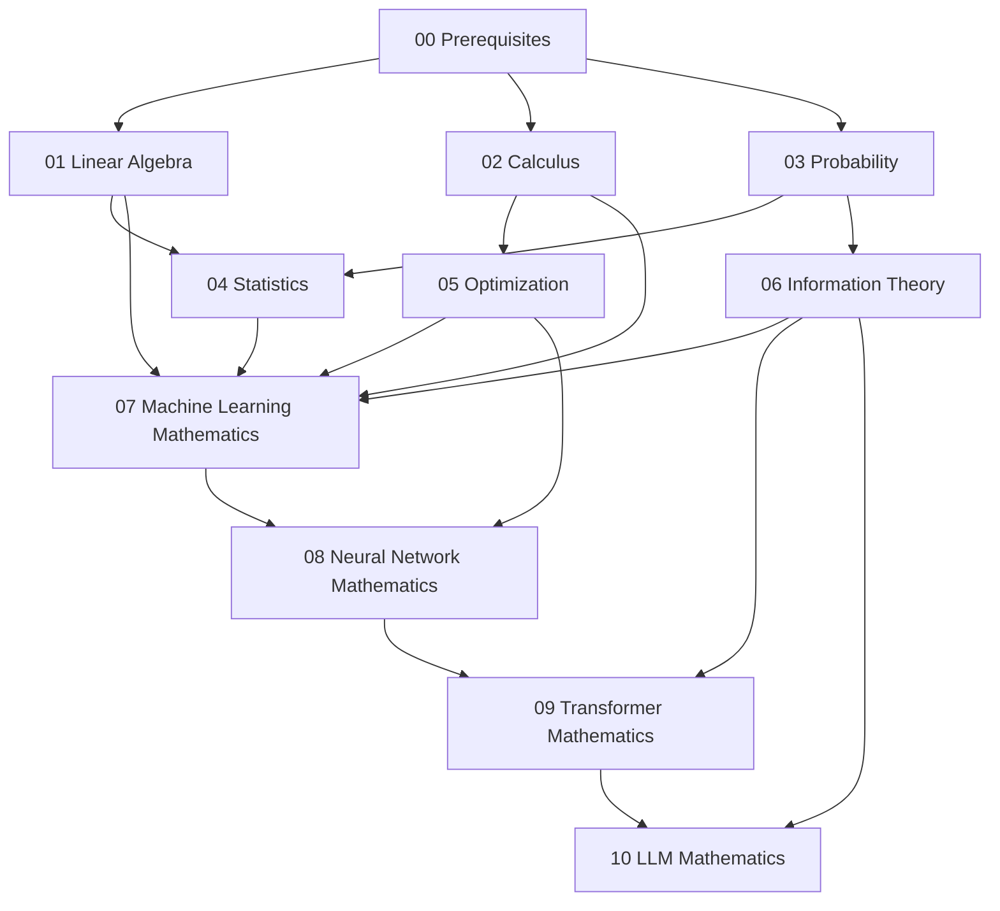

# Roadmap

The curriculum is a chain: each section assumes the ones above it. This page states what each section contains, what it depends on, and what it unlocks.

## Dependency Graph



In text form:

```text
Prerequisites
      ↓
Linear Algebra →-------------------┐
      ↓                           │
Calculus →------------------┐      │
      ↓                    │      │
Probability → Statistics →--┤      │
      ↓                    │      │
Optimization →-------------┤      │
      ↓                    │      │
Information Theory →-------┴──────┤
      ↓                           │
Machine Learning Mathematics ←────┘
      ↓
Neural Network Mathematics
      ↓
Transformer Mathematics
      ↓
LLM Mathematics
```

## Sections

### 00 — Prerequisites

**Contains:** algebra and equations, functions and graphs, exponents and logarithms, summation and set notation, basic geometry and trigonometry.

**Depends on:** nothing.

**Unlocks:** every later section. Logarithms in particular are used constantly from probability onward.

### 01 — Linear Algebra

**Contains:** vectors, dot products, norms, distance, angles, matrices, matrix multiplication, transpose, systems of equations, rank, span, basis, dimension, subspaces, orthogonality, projection, least squares, eigenvalues, symmetric and positive-definite matrices, SVD.

**Depends on:** 00.

**Unlocks:** statistics (covariance matrices), machine learning mathematics (regression, PCA), neural networks (layers as matrix multiplication), transformers (embeddings, Q/K/V).

Two chains run through this section and reappear later:

```text
Vector → Dot Product → Projection → Orthogonality → Least Squares
Matrix → Linear Transformation → Eigenvalues → SVD → PCA
```

### 02 — Calculus

**Contains:** limits, continuity, derivative and its rules, partial derivatives, gradient, directional derivative, Jacobian, Hessian, chain rule, Taylor approximation, optimization by calculus.

**Depends on:** 00 (and 01 for multivariable notation).

**Unlocks:** optimization (gradient descent is a first-order Taylor step), neural networks (backpropagation is the chain rule), everything involving training.

```text
Function → Derivative → Partial Derivatives → Gradient → Chain Rule → Backpropagation
```

### 03 — Probability

**Contains:** events and axioms, conditional probability, independence, Bayes' theorem, random variables, PMF/PDF/CDF, common distributions, expectation, variance, covariance, joint/marginal/conditional distributions.

**Depends on:** 00 (summation, functions), 01 (vectors for joint distributions appear naturally).

**Unlocks:** statistics, information theory, machine learning (logistic regression is conditional probability), language models (next-token distributions).

### 04 — Statistics

**Contains:** mean, median, variance, standard deviation, covariance, correlation, populations vs samples, estimators, bias and variance of estimators, likelihood, maximum likelihood estimation, MAP estimation, basic hypothesis testing, basic confidence intervals.

**Depends on:** 01 (covariance, matrices), 03 (expectation, distributions).

**Unlocks:** optimization (loss functions are negative log-likelihoods), machine learning mathematics, understanding what training actually estimates.

### 05 — Optimization

**Contains:** objective and loss functions, minimization and maxima, local and global minima, gradient descent derived from Taylor expansion, learning rate, stochastic gradient descent (conceptual), convexity, regularization, constrained optimization, Lagrange multipliers.

**Depends on:** 02 (gradient, Taylor), 04 (likelihood as the source of loss functions).

**Unlocks:** machine learning mathematics (every model is fit by optimization), neural network training.

### 06 — Information Theory

**Contains:** entropy, cross-entropy, KL divergence, conditional entropy, mutual information.

**Depends on:** 03 (probability), 05 (loss minimization frames cross-entropy as a loss).

**Unlocks:** machine learning mathematics (logistic regression loss), neural networks (classification loss), LLMs (training objective, perplexity).

### 07 — Machine Learning Mathematics

**Contains:** linear regression with normal equations and gradient descent, logistic regression with sigmoid and cross-entropy, PCA from covariance eigendecomposition.

**Depends on:** 01, 02, 03, 04, 05, 06 — this section is where the pieces combine.

**Unlocks:** neural networks (a network is stacked linear algebra plus calculus), transformers (attention is a learned similarity).

### 08 — Neural Network Mathematics

**Contains:** the neuron $z = wx + b$, activations $a = f(z)$, vector form $\mathbf{z} = W\mathbf{x} + \mathbf{b}$, composition of layers, loss, forward pass, backpropagation derived with the chain rule, parameter updates.

**Depends on:** 01 (matrices), 02 (chain rule, gradients), 05 (gradient descent), 06 (loss functions).

**Unlocks:** transformers (a transformer block is a specific arrangement of differentiable components).

### 09 — Transformer Mathematics

**Contains:** token embeddings, position encodings, query/key/value projections $Q = XW_Q$, $K = XW_K$, $V = XW_V$, scaled dot-product attention with the $1/\sqrt{d_k}$ derivation, softmax, causal masking, multi-head attention, residuals and layer normalization, feed-forward blocks.

**Depends on:** 01 (matrices, dot products), 02 (gradients are needed to train it, referenced), 03 (softmax as a distribution), 06 (softmax motivation).

**Unlocks:** LLM mathematics (an LLM is a transformer plus a probability objective).

### 10 — LLM Mathematics

**Contains:** the full pipeline from tokens to next-token probabilities, logits, softmax, conditional next-token probability, sequence cross-entropy training objective, perplexity, sampling, temperature.

**Depends on:** 03 (conditional probability), 06 (cross-entropy, entropy), 09 (the transformer computation).

**Unlocks:** nothing further inside this repository — it is the endpoint where all earlier mathematics meets.

## Pace

Nothing here is meant to be read in one pass per section. A reasonable study rhythm:

1. Read a chapter once without the exercises.
2. Re-derive the key formula on paper.
3. Work the exercises; check against `SOLUTIONS.md`.
4. Run the Python snippet (if any) and modify it to test your own numbers.
5. Before moving on, state out loud where the concept appears in AI.
